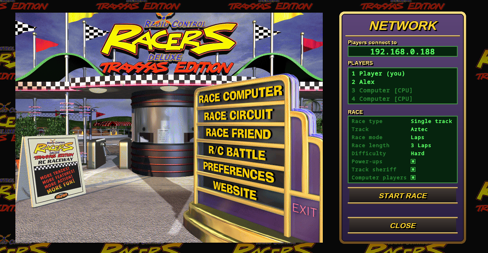

# RC Racers LAN Mod

Unofficial LAN multiplayer mod for 3D Ultra Radio Control Racers Deluxe (2000). Race up to 4 players over your local network.



## Features

- Host or join games from a panel next to the main menu
- Single races, championships and R/C Battle (Battle Ball, R/C Soccer) for 2 players
- Choose tracks and championships in the game's own menus
- Empty slots can be filled with computer players
- Players who leave are taken over by the computer
- Race options: laps or minutes, length, difficulty, power-ups, track sheriff
- Visual improvements: races fill the screen, borderless window, menu bar and tooltips are recreated faithfully
- Settings in `scripts/rclan.ini`

## Supported versions

- 3D Ultra RC Racers Deluxe, German (Graupner Edition): version 2.0, built July 28, 2000
- 3D Ultra RC Racers Deluxe Traxxas Edition, English: version 2.0, built June 6, 2000

All players need the same version of the game and the mod.

## Install

1. Download [rclan-1.0.0.zip](https://github.com/Berny23/rcracers-lan/releases/download/v1.0.0/rclan-1.0.0.zip) from the releases.
2. Extract it into the game folder (the one with `RCRacers.exe`).
3. Start the game.

If the mod is not loading automatically on Linux, add `WINEDLLOVERRIDES="winmm=n,b"` to its start parameters.

## Playing

1. One player clicks **Host Game**, chooses the race options and clicks **Start Race**.
2. The others click the game under **Games Found**, or type the host's IP address and click **Connect**.

Your firewall must allow UDP port 47624 and TCP port 47625.

## Build

```
make            # needs mingw-w64-gcc
make release    # build/rclan-1.0.0.zip
```

## Note

Only tested on Linux with Wine/Proton, not on Windows.

This project does not include any original game files. You need your own copy of the game.

Includes [Ultimate ASI Loader](https://github.com/ThirteenAG/Ultimate-ASI-Loader) (MIT license).
